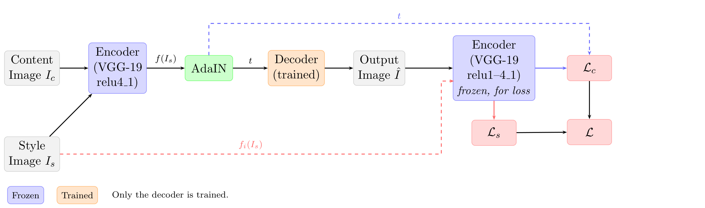
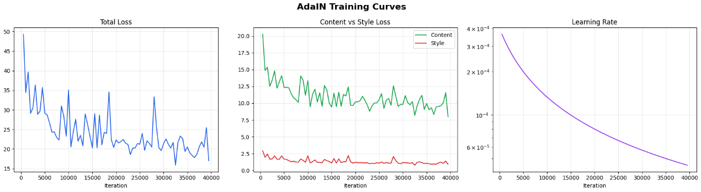
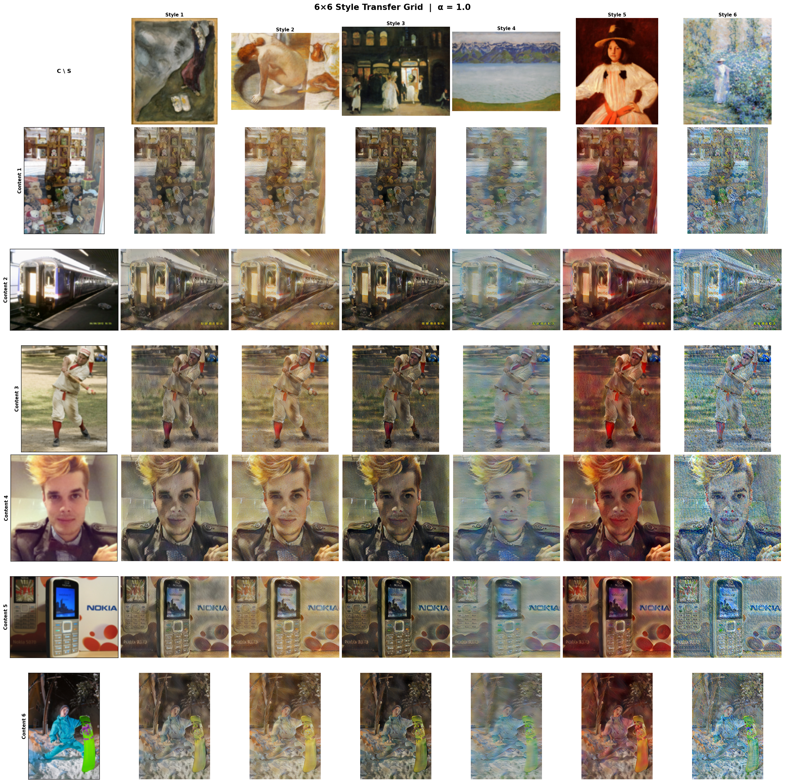
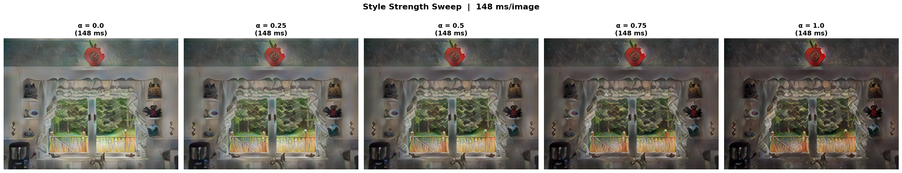

# AdaIN style transfer

This is my from-scratch rebuild of *Arbitrary Style Transfer in Real-time with Adaptive
Instance Normalization* (Huang and Belongie, ICCV 2017). A frozen VGG-19 encoder, a
parameter-free AdaIN layer and a trained mirrored decoder, trained on MS-COCO content
images and WikiArt styles across several short Kaggle sessions.

| Result | Value | Context |
| --- | --- | --- |
| Inference time | about 150 ms | 512x512 image, one T4, measured after warm-up |
| Final configuration | batch 32, 40,000 iterations | two T4 GPUs, about 7 to 8 hours |
| Planned video throughput | 15 to 30 FPS | 256 px frames, extension not measured |

> **Status:** this repository currently holds the method notes and the figures. I am adding
> the training and inference code separately, so it does not run yet.



## Method

- **Encoder.** The first four blocks of VGG-19, pretrained on ImageNet and frozen.
- **AdaIN.** Aligns the channel-wise mean and variance of the content features to those of
  the style features. No learnable parameters.
- **Decoder.** A mirror of the encoder that uses nearest-neighbour upsampling instead of
  pooling. This is the only trained component.
- **Loss.** Content loss is the MSE between the transferred feature map and the re-encoded
  output at `relu4_1`. Style loss is the MSE of the channel statistics across
  `relu1_1` to `relu4_1`. Total loss `L = Lc + 10 * Ls`.
- **Interpolation.** A style strength parameter `alpha` blends the transferred features
  with the original content features, so `alpha = 0` returns the content image and
  `alpha = 1` applies the full style.

## Training



I compared three configurations:

| Batch | Iterations | Learning rate | GPUs | Approx. time | Outcome |
| --- | --- | --- | --- | --- | --- |
| 8 | 160,000 | 1e-4 | 1 x T4 | about 16 h | Slow, quality similar to batch 32 |
| 32 | 40,000 | 4e-4 | 2 x T4 | 7 to 8 h | Selected |
| 64 | 20,000 | 8e-4 | 2 x T4 | 7 to 8 h | Weaker style transfer, rejected |

Two details made multi-session training possible on Kaggle:

- **Checkpointing.** I upload the decoder weights, optimizer state and the loss history to a
  Hugging Face model repository at every checkpoint interval. When a session starts, the
  resume cell pulls the highest checkpoint and restores everything before training
  continues.
- **Reproducible sampling.** Instead of relying on a per-epoch shuffling generator, I
  generate the index sequence for all iterations once with a fixed seed. Resuming at
  iteration k is then just a slice of that sequence.

## Results





The batch-8 against batch-32 comparison is inconclusive by construction: batch 8 ran on one
GPU and batch 32 on two, so the difference cannot be attributed to batch size alone. Batch
64 was visibly worse, which fits the reduced number of gradient updates more than the batch
size itself.

## Limitations

- 40,000 iterations instead of the paper's 160,000, so fine texture detail falls short of
  the original.
- The planned video pipeline processes frames independently and has no temporal
  consistency mechanism, so flicker is expected on high-motion footage.
- Style is represented entirely by VGG-19 feature statistics.

## Repository layout

```text
assets/                   architecture, training curves, qualitative grid, alpha sweep
data/README.md            dataset sources (MS-COCO 2017 and WikiArt)
```

Commit dates reflect when the work was done. I reconstructed the history from the report and
its figures, because the training code lived in ephemeral Kaggle sessions.

## Team and context

This was a course project for the Deep Learning module (ESI-SBA, 2025/2026, taught by Prof.
N. Dif). We worked as a team of four.

I implemented the AdaIN encoder and decoder, owned the 2xT4 DataParallel runs, the batch
size and iteration comparisons, the Hugging Face checkpointing and resume, and the 512x512
inference benchmark. We shared the literature study and the report.

## References

- X. Huang and S. Belongie (2017), "Arbitrary Style Transfer in Real-time with Adaptive
  Instance Normalization", ICCV.
- L. A. Gatys, A. S. Ecker and M. Bethge (2015), "A Neural Algorithm of Artistic Style".
- J. Johnson, A. Alahi and L. Fei-Fei (2016), "Perceptual Losses for Real-Time Style
  Transfer and Super-Resolution", ECCV.
- K. Simonyan and A. Zisserman (2014), "Very Deep Convolutional Networks for Large-Scale
  Image Recognition".

More about this project on my portfolio:
https://safouane-medjahri.vercel.app/projects/adain-style-transfer
